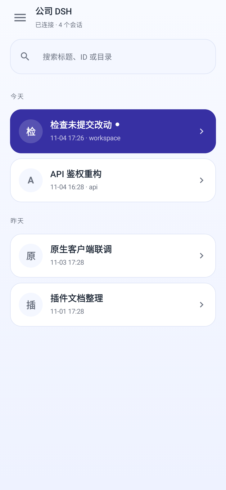
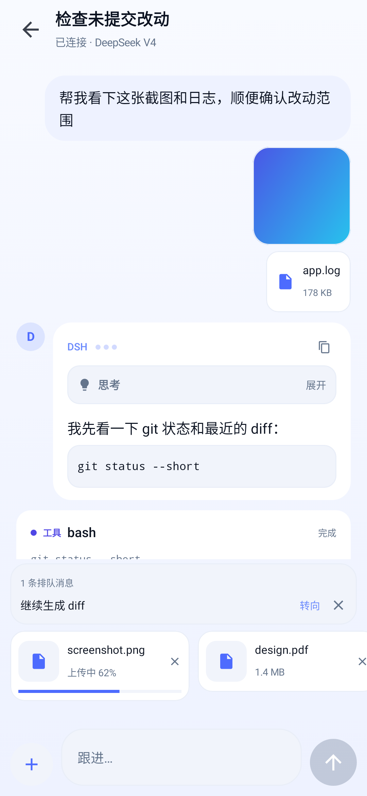
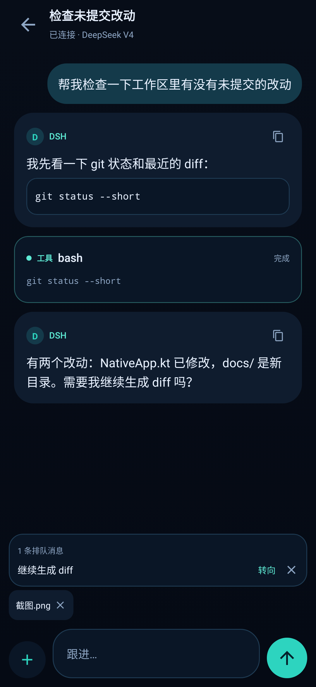

# DSH 原生 Android 客户端（0.19.12）

这不是 WebView 壳。它直接对接 DSH 的 Remote API：

- 原生配对：OkHttp 提交配对码、跟随 303 完成 DSH 登录、持久化 cookie
- 原生会话列表：`session/list`
- 原生会话流：WebSocket `/api/remote.mux` 上的 `session/follow`
- 原生消息：用户/助手消息、思考块、工具调用与工具结果卡片
- 原生发送：`session/prompt`
- 原生文件：`workspaceFiles/list` + `workspaceFiles/read`，目录导航与文本预览
- 多 DSH：本地配置清单，切换时使用各自的 cookie jar

当前覆盖日常使用的核心链路；终端使用 WebView + xterm 兜底，后续可替换为原生 VT100。







当前默认主题为「纸白」：暖白纸感背景 + 靛蓝强调色；右上角月亮/太阳图标可切换回「深海」暗色主题，选择会持久化。卡片圆角、字号层级、工具卡片配色、启动页与图标都已同步为纸白风格。

## 已完成

| 能力 | 状态 |
| --- | --- |
| 配对 / 多 DSH | ✅ |
| 会话列表 | ✅ |
| 打开会话、历史快照 | ✅ |
| 实时事件 / assistant 文本流 | ✅ |
| 发送消息 | ✅ |
| 工具调用卡片 | ✅ 通用卡片，专用渲染后续 |
| 文件目录 / 文本预览 | ✅ |
| 终端 | ✅ WebView + xterm，通过 terminal/attach 流式输出 |
| 二维码扫描 | ✅ ZXing 扫码，自动填地址与配对码 |
| 模型选择 | ✅ `session/modelCatalog` + `session/selectModel` |
| 专用工具摘要 | ✅ bash/read/write/grep/subagent 参数摘要 |
| 附件 | ✅ 相册/拍照/文件入口；图片压缩到长边 1600px；上传进度/失败重试；待发送状态卡 |
| 排队消息 | ✅ 解析 `agent/inbox/spliced`，支持移除/转向 |
| 主题 | ✅ 纸白 / 深海双主题，可切换并持久化 |
| 启动页/图标 | ✅ 纸白底 + 靛蓝 D 图标，Android 12 Splash 同步 |
| 会话列表 | ✅ 标题/目录/时间、搜索、今天/昨天分组 |
| 消息渲染 | ✅ Markdown、图片缩略图/全屏预览、文件卡片、助手流式三点、回到底部 |
| 思考折叠/翻译 | ✅ 思考块默认折叠，展开自动翻译（Bing，回退 Google）；译文落盘缓存；设置可改为默认展开 |
| 通知与后台 | ✅ 需要回答/任务完成/出错推送通知，点通知直达会话；可选前台服务保持后台连接 |
| 任务与进度 | ✅ 运行中的会话、目标、todo（解析 todo_write）、最近工具调用时间线 |
| 收件箱动作 | ✅ 单问题单选项可直接在收件箱回答回传；问题通知带「打开处理」 |
| 聊天时间 | ✅ 消息时间戳 + 今天/昨天/日期分隔 |
| 语音 | ✅ 系统语音输入进输入框；助手消息一键朗读（TTS） |
| 设计系统 | ✅ Ink 设计语言（design/design-tokens.json） |
| Now 首页 | ✅ 需要你 → 运行中 → 最近完成 三段式；任务/文件/设置导航 |
| 导航自定义 | ✅ 排序、显隐、至少 2 个、最多 4 个、隐藏收进「更多」、恢复默认 |
| 长消息折叠 | ✅ 超过 1200 字的消息默认收起，点「展开全文」 |

## 构建

```bash
cp local.properties.example local.properties  # 改成你的 SDK 路径
./gradlew assembleRelease
# app/build/outputs/apk/release/app-release.apk
```

环境：JDK 17、Android SDK 34、Gradle 8.7。

**release 必须使用固定的发布证书。** 把 `android/keystore/keystore.properties` 放好（该目录被 gitignore）：

```properties
storeFile=keystore/dshnative-release.jks
storePassword=…
keyAlias=dshnative
keyPassword=…
```

没有 keystore 时 Gradle 会退回 debug 签名——这样的 APK 与已安装的正式版签名不一致，**无法覆盖安装**，不能发布。

## 发布

发布需要一个 release 签名 APK，以及清单签名私钥（ECDSA P-256，对应客户端内置公钥）：

```bash
ANDROID_MANIFEST_KEY=/path/to/manifest-signing.pem \
  node updates/publish-android.mjs \
  android/app/build/outputs/apk/release/app-release.apk \
  "附件与消息列表重设计，新增上传进度 / 失败重试"

git add updates/DSHNative-<版本>.apk updates/android.json
git commit -m "release: <版本>"
git push origin main
```

脚本会：拒绝 debug 签名 APK → 复制 APK 到 `updates/` → 计算 SHA-256 → 写 `updates/android.json`（绝对 URL）→ 用私钥签名清单 → 校验私钥是否与客户端内置公钥匹配。客户端「设置 → 检查更新」即可拿到本次发布。

## 协议

DSH 的浏览器与原生共用两套传输：

**Unary** — `POST {base}api/<endpoint>`：

```json
{"type":"client-request","rpcId":"<uuid>","method":"session/list","payload":{"args":{"_request":{}}}}
```

响应：

```json
{"type":"server-response","rpcId":"…","result":{"ok":true,"value":{…}}}
```

**Streams** — WebSocket `{ws|wss}://host/phone/api/remote.mux`：

```json
{"type":"open","streamId":"<uuid>","endpoint":"session/follow","payload":{"args":{"request":{…}}}}
```

服务端返回 `item` / `end` / `error` 帧，`item.value` 可能是 `snapshot`、`event` 或 `assistant-stream`。

认证使用配对后写入的 `HttpOnly` cookie；原生端用每个 DSH 独立的持久化 CookieJar 复用同一套设备/会话凭据。

## 测试

```bash
# 离线：编译 + Compose 原生渲染截图
./gradlew testDebugUnitTest

# 在线协议测试：需要一个真实配对码
DSH_PAIR_CODE=ABCD1234 ./gradlew testDebugUnitTest --tests '*DshClientLiveTest*'
```

在线测试会验证：配对 → `session/list` → `session/follow` 快照 → `workspaceFiles/list`。  
最近一次实测：`sessions=9`、`files=10`、`file preview=2700 chars`、`upload receipt ok`、`terminal screen=64`、`model groups=1`、`selectModel ok`；另一轮 `snapshot records=147 / items=55 / tools=15`，并完成真实 prompt → `assistant/message` 的流式验证。真实队列测试也通过：长任务运行中插入排队消息，观察到 insert 与 removal。

## 目录

```
app/src/main/java/com/ila3/dshnative/
├── protocol/
│   ├── DshClient.kt      # 配对、unary、WebSocket mux、文件 API
│   ├── CookieStore.kt    # 每 DSH 持久化 cookie jar
│   ├── NativeStore.kt    # 多 DSH 清单
│   └── ChatItems.kt      # 会话事件 → 原生消息/工具卡片
├── ui/
│   ├── NativeViewModel.kt
│   ├── NativeApp.kt      # Compose：服务器、会话、聊天、文件
│   └── Theme.kt
└── MainActivity.kt
```

## 下一阶段

1. 终端已完成 WebView + xterm；后续评估原生 VT100
2. 二维码扫描已完成；可继续补扫一扫后自动连接
3. 工具专用卡片继续细化（bash/read/write/search/subagent）
4. 会话标题、队列、附件预览
5. Markdown/代码高亮、复制/重试/中断
